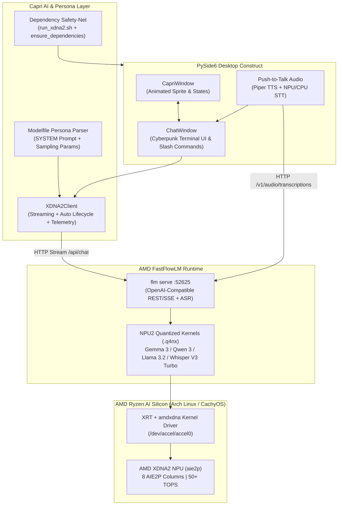

# Capri — The Desktop Construct (AMD XDNA2 Powered Edition)

[](https://www.amd.com/en/products/processors/consumer/ryzen-ai.html)
[](https://github.com/FastFlowLM/FastFlowLM)
[](https://www.python.org/)
[](https://wiki.qt.io/Qt_for_Python)
[](https://github.com/MrProper0592/Capri-Capricorn-The-Desktop-Construct-AMD-XDNA2-POWERED)

*A local-first Cyberpunk 2077 desktop companion built exclusively for **Arch Linux / CachyOS** and accelerated natively on your AMD Ryzen AI XDNA2 NPU (`aie2p`) — zero cloud APIs, zero GPU VRAM tax.*

---

## Overview

**Capri** is a lightweight, animated desktop construct inspired by the atmosphere of **Cyberpunk 2077**. She hangs out directly on your desktop with idle animations, expressive reactions, voice input/output, and a compact terminal-style chat window.

> **Upstream Credit:** Originally created by [**Juliowiwiwiwi**](https://github.com/Juliowiwiwiwi/Capri-Capricorn-The-Desktop-Construct) as an Ollama desktop companion.

### What This AMD XDNA2 (Arch Linux / CachyOS) Edition Adds

While running an LLM companion on your discrete GPU eats precious VRAM and spikes power draw while gaming or working, this fork offloads **both LLM text generation and Whisper Speech-to-Text** directly onto the **AMD Ryzen AI XDNA2 NPU (`aie2p`)** via **FastFlowLM (`flm`)** and the native Arch Linux / CachyOS **XRT (`amdxdna`)** driver stack:

- **100% GPU & CPU Offload:** Leaves your Radeon / NVIDIA GPU and CPU cores completely free for games, rendering, or compiling while Capri runs on dedicated NPU silicon at ultra-low wattage.
- **Pure Arch Linux & CachyOS Native:** Built specifically for the Linux `amdxdna` (`/dev/accel/accel0`), `xrt`, and `fastflowlm` stack with full Wayland/X11 compositor transparency and frameless window positioning.
- **Automated Dependency Safety-Net (`run_xdna2.sh` & `capri/main.py`):** Self-healing startup checks that automatically verify and bootstrap system audio libraries (`portaudio`, `libsndfile` via `pacman`), `RLIMIT_MEMLOCK` DMA limits (`ulimit -l`), FastFlowLM NPU2 models (`gemma3:4b` & `whisper-v3:turbo`), and `.venv` Python packages (`PySide6`, `numpy`, `sounddevice`, `soundfile`, `pynput`, `requests`).
- **Zero-Ollama Requirement:** Reads and parses the original `Modelfile` (`SYSTEM` prompt + sampling parameters) directly in Python and injects Capri's authentic Night City personality straight into the FastFlowLM NPU pipeline.

---

## Preview

### Capri on the Desktop


### Capri with the Cyberpunk Chat Terminal Open


---

## Key XDNA2 Additions & Features

- **Native XDNA2 NPU (`aie2p`) LLM Inference:** Runs `.q4nx` quantized NPU2 kernels directly across all 8 AIE2P columns using FastFlowLM (`gemma3:4b`, `qwen3:4b`, `qwen3:1.7b`, `qwen3:0.6b`, `llama3.2:3b`, `phi4-mini-it:4b`).
- **XDNA2 NPU Speech-to-Text (ASR) + Local Voice Pipeline:** Hardware-accelerated push-to-talk transcription via `whisper-v3:turbo` (`Whisper-V3-Turbo-NPU2`) with automatic `faster-whisper` fallback, paired with ultra-fast local `Piper` neural Text-to-Speech (`en_US-libritts-high.onnx`).
- **Zero-Config `Modelfile` Persona Engine:** Automatically parses the repository's `Modelfile` (`SYSTEM` block, `temperature`, `num_ctx`, `repeat_penalty`) and injects Capri's Cyberpunk 2077 persona directly into the FastFlowLM NPU stream—no `ollama create` step required.
- **Self-Healing Dependency Safety-Net:** Both `./run_xdna2.sh` and `capri/main.py` (`ensure_dependencies()`) automatically verify Arch/CachyOS packages, `memlock` limits, NPU2 models, and Python dependencies so missing packages never crash with raw tracebacks.
- **Auto-Managed NPU Server Lifecycle:** Automatically inspects `/dev/accel/accel0` (`amdxdna`), checks Linux `memlock` (`RLIMIT_MEMLOCK`) limits for XRT DMA buffer mapping, and spawns/manages `flm serve` in the background with configurable NPU power modes (`powersaver`, `balanced`, `performance`, `turbo`).
- **Cyberpunk Terminal Commands & Live Telemetry:** Built-in slash commands (`/npu`, `/model <tag>`, `/clear`, `/help`) inside Capri's chat window displaying live XDNA2 column usage, XRT firmware version, active NPU power mode, and real-time token generation speed (`tok/s`).
- **Multi-Backend Flexibility:** Seamlessly switch between **AMD FastFlowLM (`xdna2`)**, **AMD Lemonade Server (`openai`)**, or classic **Ollama (`ollama`)** via CLI flags or environment variables.

---

## Architecture



---

## Supported XDNA2 NPU2 Models

All models below execute natively on the **XDNA2 (`aie2p`)** NPU using `.q4nx` 4-bit NPU-optimized weights via FastFlowLM:

| Model Tag (`flm`) | Architecture | Approx. RAM / DMA Footprint | Recommended Use Case |
| :--- | :--- | :---: | :--- |
| **`gemma3:4b`** *(Default)* | Google Gemma 3 4B Instruct (`.q4nx`) | ~3.1 GB | **Best overall Capri persona fidelity**, natural Night City banter & nuance |
| **`qwen3:4b`** | Qwen 3 4B Instruct (`.q4nx`) | ~2.9 GB | Strong coding, technical debugging & reasoning companion |
| **`llama3.2:3b`** | Meta Llama 3.2 3B Instruct (`.q4nx`) | ~2.3 GB | Fast, punchy conversational replies with low memory overhead |
| **`phi4-mini-it:4b`** | Microsoft Phi-4 Mini Instruct (`.q4nx`) | ~2.8 GB | Dense logic, study help, and concise technical answers |
| **`qwen3:1.7b`** | Qwen 3 1.7B Instruct (`.q4nx`) | ~1.4 GB | High-speed ~35+ tok/s snappy banter while heavy gaming |
| **`qwen3:0.6b`** | Qwen 3 0.6B Instruct (`.q4nx`) | ~0.6 GB | Ultra-lightweight instant responses & minimal memory footprint |
| **`whisper-v3:turbo`** | OpenAI Whisper V3 Turbo (`NPU2`) | ~1.1 GB | Hardware-accelerated Push-to-Talk Speech-to-Text on XDNA2 |

---

## Hardware & Software Requirements

### Supported Silicon
- **AMD Ryzen AI 300 Series** processors featuring the **XDNA2 (`aie2p`)** NPU architecture (8 AIE2P columns, 50–55 TOPS):
  - **Strix Point / Krackan Point:** Ryzen AI 7 350, Ryzen AI 9 365, Ryzen AI 9 HX 370, Ryzen AI 9 HX 375
  - **Strix Halo:** Ryzen AI Max / Max+ 385, 390, 395

### Operating System & Drivers (Arch Linux / CachyOS)

1. **Arch Linux / CachyOS (Linux Kernel 6.14+)** with the **`amdxdna`** accelerator driver loaded (`/dev/accel/accel0` present).
2. **XRT (Xilinx Runtime)** with the NPU plugin installed (`/opt/xilinx/xrt` / `xrt-smi`).
3. **FastFlowLM (`flm`)** binary installed and on your `PATH` (or at `/opt/fastflowlm/bin/flm`).
4. **System Audio Packages:** `portaudio` and `libsndfile` (automatically verified and installed by `./run_xdna2.sh` via `pacman`).
5. **Unlocked DMA Memory Lock (`memlock`) Limit** *(Critical for Linux XRT)*:
   XRT maps NPU `.q4nx` weights into pinned DMA pages. The default limit causes `mmap failed (err=-11): Resource temporarily unavailable`. `./run_xdna2.sh` automatically checks `ulimit -l` and applies `/etc/security/limits.d/99-xdna-npu.conf` + `prlimit`, or you can configure it manually:
   ```bash
   sudo tee /etc/security/limits.d/99-xdna-npu.conf << 'EOF'
   * soft memlock unlimited
   * hard memlock unlimited
   EOF
   ```

---

## Automated Dependency Safety-Net

Capri includes a two-layer **Dependency Safety-Net** designed for Arch Linux and CachyOS so you never hit cryptic missing-library crashes:

1. **Launcher Safety-Net (`./run_xdna2.sh`):**
   - **Arch/CachyOS System Libraries:** Verifies `python3`, `libportaudio.so` (`portaudio`), `libsndfile.so` (`libsndfile`), `/dev/accel/accel0` (`amdxdna`), `xrt-smi` (`xrt`), and `flm` (`fastflowlm`). Automatically invokes `pkexec pacman -S --needed --noconfirm` if system libraries are missing.
   - **XRT DMA `memlock` Auto-Fix:** Checks `ulimit -l`. If `< 16 GB` and not `unlimited`, automatically writes `/etc/security/limits.d/99-xdna-npu.conf` and elevates the current process limit via `prlimit` (`pkexec`).
   - **NPU2 Model Auto-Bootstrap:** Checks `flm list --filter installed` and automatically pulls `gemma3:4b` and `whisper-v3:turbo` if missing.
   - **Python `.venv` Auto-Heal:** Creates `.venv` if absent and verifies `PySide6`, `numpy`, `sounddevice`, `soundfile`, `pynput`, and `requests` are importable before launching—automatically running `uv pip install` or `pip install -r requirements.txt` if any package is missing.
2. **Python Startup Safety-Net (`capri/main.py` — `ensure_dependencies()`):**
   - Runs before `PySide6` or voice modules are imported. If you invoke `python -m capri.main` directly with missing packages, it automatically attempts to install `requirements.txt` via `pip` / `uv pip` or prints a clean, actionable Arch/CachyOS guide instead of a raw `ModuleNotFoundError`.
   - `capri/voice/text_to_speech.py` and `capri/voice/speech_to_text.py` use lazy/safe imports for `sounddevice` and `soundfile` so missing audio libraries never crash module import.

---

## Quick Start (Arch Linux / CachyOS)

### 1. Clone the Repository

```bash
git clone https://github.com/MrProper0592/Capri-Capricorn-The-Desktop-Construct-AMD-XDNA2-POWERED.git
cd Capri-Capricorn-The-Desktop-Construct-AMD-XDNA2-POWERED
```

### 2. One-Command Launch (Recommended — Auto-Bootstraps Everything)

`./run_xdna2.sh` automatically verifies your Arch Linux / CachyOS packages, `memlock` limit, `.venv` Python environment, and NPU2 models (`gemma3:4b` + `whisper-v3:turbo`):

```bash
chmod +x run_xdna2.sh
./run_xdna2.sh
```

### 3. Verify Your XDNA2 NPU Hardware

Run the built-in diagnostic check to inspect `/dev/accel/accel0`, XRT, `memlock`, and FastFlowLM status:

```bash
./run_xdna2.sh --check-npu
# or directly via .venv:
.venv/bin/python -m capri.main --check-npu
```

### 4. Manual Setup & Direct Python CLI (Optional)

If you prefer managing the virtual environment and models manually on Arch Linux / CachyOS:

```bash
sudo pacman -S --needed python portaudio libsndfile
flm pull gemma3:4b
flm pull whisper-v3:turbo

python3 -m venv .venv
source .venv/bin/activate
pip install -r requirements.txt

python -m capri.main --backend xdna2 --model gemma3:4b --pmode performance
```

- **Left-click** Capri on your desktop to open/close the Cyberpunk terminal chat.
- **Drag** Capri anywhere on your screen.
- **Hold `LEFT CTRL`** anywhere to talk to her via Push-to-Talk (when voice components are enabled).
- **Right-click** Capri to open the context menu or exit cleanly.

---

## CLI Reference & Terminal Slash Commands

### Command-Line Arguments (`python -m capri.main`)

| Flag / Option | Environment Variable | Default | Description |
| :--- | :--- | :---: | :--- |
| `--backend {auto,xdna2,ollama,openai}` | `CAPRI_BACKEND` | `xdna2` | Select AI inference backend (`xdna2` = FastFlowLM NPU, `openai` = Lemonade/OpenAI API, `ollama` = local Ollama) |
| `--model <tag>` | `CAPRI_MODEL` | `gemma3:4b` | Model tag to run on the selected backend (e.g. `gemma3:4b`, `qwen3:4b`, `qwen3:1.7b`) |
| `--pmode {powersaver,balanced,performance,turbo}` | `CAPRI_PMODE` | `performance` | AMD XDNA2 NPU clock/power profile passed to `flm serve` |
| `--port <int>` | `CAPRI_PORT` | `52625` | Local port for FastFlowLM `flm serve` |
| `--no-auto-serve` | — | `False` | Do not auto-spawn `flm serve` if the server is not already running |
| `--check-npu` | — | — | Run XDNA2 hardware, driver, `memlock`, and `flm` readiness check and exit |

### In-Chat Cyberpunk Terminal Slash Commands

Type these directly into Capri's terminal input bar:

| Command | Description |
| :--- | :--- |
| `/npu` | Displays live **AMD XDNA2 NPU (`aie2p`)** telemetry: device node, PCI BDF, firmware version, active AIE2P columns, power mode, and last generation throughput (`tok/s`). |
| `/model <tag>` | Hot-swaps the active NPU model on the fly (e.g., `/model qwen3:4b` or `/model qwen3:1.7b`). |
| `/clear` | Wipes the current terminal scrollback and resets short-term conversation context while keeping Capri's `Modelfile` persona intact. |
| `/help` | Lists available terminal slash commands and active backend status. |

---

## Customizing Capri's Personality (`Modelfile`)

Capri's personality lives in a single place: the root [`Modelfile`](Modelfile).

- **On `xdna2` / `openai` backends:** `XDNA2Client` parses the `Modelfile` automatically on startup—extracting the `SYSTEM """..."""` prompt and `PARAMETER` values (`temperature`, `num_ctx`, `repeat_penalty`). Simply edit `Modelfile` and restart Capri (or type `/clear`)—no rebuilding needed!
- **On `ollama` backend:** Rebuild the custom Ollama tag after editing `Modelfile`:
  ```bash
  ollama create capri -f ./Modelfile
  .venv/bin/python -m capri.main --backend ollama --model capri:latest
  ```

---

## Troubleshooting (Arch Linux / CachyOS)

### 1. `[XRT] ERROR: mmap failed (err=-11): Resource temporarily unavailable`
**Cause:** Your Linux user session has a restricted `memlock` (`RLIMIT_MEMLOCK`) limit, preventing the `amdxdna` driver from pinning `.q4nx` model buffers in DMA memory for the NPU.

**Fix:**
1. Launch via `./run_xdna2.sh` (which automatically applies the `memlock` fix via `pkexec`), or create `/etc/security/limits.d/99-xdna-npu.conf`:
   ```bash
   echo -e "* soft memlock unlimited\n* hard memlock unlimited" | sudo tee /etc/security/limits.d/99-xdna-npu.conf
   ```
2. If you launch your desktop via `systemd` user services or a display manager, also ensure `/etc/systemd/user.conf` and `/etc/systemd/system.conf` include `DefaultLimitMEMLOCK=infinity`, then reboot or re-login.

### 2. `/dev/accel/accel0` Not Found on Arch Linux / CachyOS
**Cause:** The `amdxdna` kernel module is not loaded or your user lacks device permissions.

**Fix:**
```bash
sudo modprobe amdxdna
ls -l /dev/accel/accel0
sudo usermod -aG render,video $USER
```

### 3. `flm serve` Is Already Running on Port `52625`
Capri automatically detects an existing `flm serve` instance on `127.0.0.1:52625` and reuses it. If you want to change the NPU power mode (`--pmode turbo`) or switch models cleanly, stop the existing daemon first:
```bash
pkill -f "flm serve"
./run_xdna2.sh
```

### 4. Voice Input / Piper TTS Not Loading
If `faster-whisper`, `sounddevice`, or the `piper` binary/voice model (`en_US-libritts-high.onnx`) is missing, Capri gracefully falls back to **text-only mode** without crashing. Check console logs on startup for exact paths (`~/.local/share/piper/piper` and `~/.local/share/piper/voices/`).

---

## Credits & Acknowledgments

- **Original Creator:** [**Juliowiwiwiwi**](https://github.com/Juliowiwiwiwi/Capri-Capricorn-The-Desktop-Construct) — Original Capri character artwork, animations, Cyberpunk 2077 `Modelfile` writing, and PySide6 desktop pet design.
- **AMD XDNA2 NPU Port & FastFlowLM Integration:** [**MrProper0592**](https://github.com/MrProper0592/Capri-Capricorn-The-Desktop-Construct-AMD-XDNA2-POWERED) — Native AMD Ryzen AI XDNA2 (`aie2p`) engine, zero-config `Modelfile` parser, NPU lifecycle manager, live telemetry terminal commands, and Arch Linux / CachyOS self-healing desktop support.
- **FastFlowLM Team:** For the ultra-fast `.q4nx` NPU2 execution runtime on AMD Ryzen AI XDNA2 silicon.
